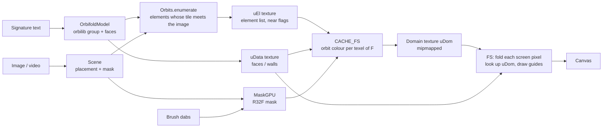

# Orbipix: how it works, and how to bring it into SymmHub

As of 2026-11-23. Orbipix: `claude-code-sessions/orbipix/` (commit a0e560d), live at
https://chaimgoodmanstrauss.com/orbipix/. SymmHub: `~/Archive/Programming/ orbifold webgl/SymmHub`
(branch `brushing_cgs`, commit 906ba4c).

**Bottom line.** Orbipix is a SymmHub-style image pattern with a different *combine rule*. SymmHub's
sympix already finds the "crown" (the group elements whose tiles meet the image) and composites those
copies, first hit or depth-sorted. Orbipix finds the same set, but colours each orbit with a **weighted
average** (or highest-weight) of the image over the orbit, with weights from a **brushable mask**. The
integration is mostly: one new visualization layer, one mask texture owned by that layer, and one brush
tool. The orbifold engine itself is already SymmHub's.

---

## 1. What Orbipix does

Orbipix turns any bitmap into a symmetric pattern for any orbifold signature (sphere, plane, hyperbolic
plane). It implements the patent draft "Method for producing symmetric patterns with contravariant
distributions" (C. Goodman-Strauss).

- A symmetry group G splits the world into orbits; every point of an orbit must get one colour.
- The image is placed in the world. For an output point p, its orbit *on the image* is
  { g(f) : g ∈ G, g(f) lies on the image }, where f is p folded into the fundamental domain F.
- The colour of p is a combination of the image colours at those points, with weights w from a mask
  over the image:

  | Mode (`settings.avg`) | Colour of the orbit | Patent |
  |---|---|---|
  | Height map `'height'` (default) | average of the copies with the greatest mask height (within 0.004) | claim 3 |
  | Contravariant `'mean'` | Σ w·c / Σ w, with Σ w = 1 over each orbit | claim 1 |
  | First hit `'first'` | first copy in the list that lands on an opaque pixel | (= SymmHub's crown) |

- Image alpha multiplies every weight. A near-white background connected to the image edge is made
  transparent (`Scene.clearWhiteBackground`).
- Video and camera input re-upload each frame.

## 2. Code map

App code in `js/` (~4,900 lines). SymmHub's engine is vendored read-only in `vendor/symmhub/`
(26 files of `lib/invlib` + `lib/orbilib`, branch `sympix-orbifold2`, commit 004327e, copied 2026-11-17;
see `vendor/SOURCE.md`).

| File | Lines | Role | SymmHub counterpart |
|---|---|---|---|
| `OrbifoldModel.js` | 706 | Signature → group and geometry (faces, walls, transforms) via `WallPaperGroup_General` and the `iGroup_*` builders; reducer (fold) | `orbilib` itself; `apps/orbifold` |
| `Signature.js`, `SignatureEditor.js`, `ParamStore.js` | 412 | Signature text, editor, headless parameter store (replaces dat.gui) | `OrbifoldUITool.js`, datgui params |
| `Orbits.js` | 290 | **Image placement ↔ world**, element algebra (Möbius / rotation), **orbit enumeration over the image**, translation lattice | `CrownCalculator.js`, `drawlib/Orbits.js` |
| `Scene.js` | 327 | Image, placement (`place`), mask state, element list cache, rigid moves of the image | `PatternImage.js`, `PatternTransform*` |
| `PatternView.js` | 1085 | WebGL2 renderer: fold shader, **orbit-colour shader**, domain-texture cache, guides, views (disk / plane / globe) | `SymRenderer`, `VisualizationImage`, `colorImageArray.glsl` |
| `MaskGPU.js` | 358 | **Mask as R32F ping-pong textures**: bake, fill, upload, read back, **contravariant brush pass**, active-element texture | none (new) |
| `FeatureTool.js` | 618 | Hover / drag of edges, cones, handles; alt-click add/remove cones; twist shear on 2222 | `OrbifoldUITool`, `GroupHandlesTool` |
| `Motif.js`, `Highlight.js`, `textures.js`, `geom.js` | ~420 | Comma motif, highlight colours, default pictures, small complex / Möbius / 3D maths | `invlib` |
| `main.js`, `Saved.js`, `presets.js` | ~620 | Wiring, undo (60 steps), URL / clipboard state, IndexedDB last state | `SymRendererScripting`, `SymmetryUndo` |
| `js/shims/invlib-modules.js` | 241 | Import-map replacement for `invlib/modules.js` without twgl / uilib / dat.gui | — |

## 3. The pipeline

1. **Group.** `OrbifoldModel._buildGroup` runs `WallPaperGroup_General.updateTheGroup()` for spherical and
   hyperbolic signatures; Euclidean ones use the `iGroup_*` builders directly (`EUC_BUILDERS`), because
   the engine's `iWallpaperGroup()` dispatcher calls `getParam` without importing it.
2. **Geometry.** Faces (walls + pairing transforms) are converted to closed-form elements:
   2D `{M: [a,b,c,d] complex, conj}` with g(z) = (aZ + b)/(cZ + d), Z = conj ? z̄ : z; sphere `{R: 3×3}`.
3. **Enumeration** (`Orbits.enumerate`): breadth-first walk over tiles from the tile under the image
   centre, keeping tiles whose bounding box meets the image. Capped at 768 elements (`MAX_COPIES` 4096 is
   the shader bound); hyperbolic tiles smaller than about one image pixel are dropped. Elements of tiles
   near F get a `near` flag (used by the analytic domain mask).
4. **Domain texture** (`CACHE_FS`): the expensive orbit sum runs once per texel of a chart of F (the world
   box round F in 2D; stereographic about the comma on the sphere), premultiplied and mipmapped. Rebuilt
   only when the group, placement, image or mask changes.
5. **Screen pass** (`FS`): each pixel → world (Möbius view, plane, or globe rotation) → fold into F →
   sample `uDom`. Tile edges, cones and hover highlights are drawn from the folded point, so they appear
   on every copy. Redraw ≈ 2–3 ms.

## 4. Core maths

### Image placement

The image lives in the *image plane*: the world itself in 2D; on the sphere, the stereographic plane from
pole (0, 0, pole). Image coordinates (u, v) map by

    s = ((u − ½)·W/L, (½ − v)·H/L)·2,   L = max(W, H)
    z = c + a·(flip ? s̄ : s)              (a complex: scale + rotation)
    world = iso(z)

`place.iso` is an isometry of the world (2D element or sphere rotation). In the disk, c = 0 always and the
image's position is carried by `iso` alone, so every move is rigid in the hyperbolic metric and the image
can never leave the disk. `Scene._canonHyp` converts old placements (frame ← τ_c, a ← a/(1 − |c|²)).

### Re-centring

On pan steps and at the end of image drags (`recenterAll` in `main.js`):
- **View:** if the canvas centre leaves F, the world is re-expressed by the orientation-preserving group
  element bringing it back (V ← V∘W, image iso ← W⁻¹∘iso). Nothing moves on screen; long pans never drift
  to the rim.
- **Image** (`Scene.recenter`): of the image's copies, the one that best covers the canvas centre becomes
  the placed copy (iso ← g∘iso), with 0.02 hysteresis.

### Masks

| | Height map | Contravariant |
|---|---|---|
| Starts as | flat 0.5 (no texture; `maskMode 'domain'`) | F, feathered by signed distance, computed analytically in the shader |
| Brushing | raise / lower under the brush only (`uContra = 0`) | contravariant: see below |
| On signature change | kept (belongs to the image) | reset to the domain (`Scene.symmetryChanged`) |
| Storage once brushed | R32F texture, ≤ 1024 px long side | same |

**Contravariant brush** (patent, "Masks"; claim 12), one GPU pass per pointer move (≤ 48 dabs):
- brush footprint B = 1 − Π(1 − bᵢ) over the move's dabs;
- a mask pixel y under the brush: new = old ± B(y);
- any other pixel: fold it, walk its orbit's copies, and at the first copy x under the brush scale it by
  (1 − newₓ)/(1 − oldₓ), so each orbit's weights still sum to one.

Cost history: CPU scatter (speckled) → CPU gather 50 ms/dab → no per-pixel fold 10 ms → GPU 3.4 ms per
pass regardless of dab count (`*2223`, 125 copies).

An **active-element texture** (`MaskGPU.activeTexture`) marks which elements touch non-zero mask, in
blocks of 16, so the contravariant shader skips copies with no weight.

### Element representation vs SymmHub

| | Orbipix | SymmHub crown |
|---|---|---|
| Element | one closed-form Möbius (2×2 complex + conj) or 3×3 rotation | a word of sphere/plane reflections (iSplanes), applied in sequence |
| GPU layout | `uEl` texture, fixed columns per element | `uCrownData` float texture: offsets → reflection lists |
| Cost per copy | one Möbius apply | `refCount` inversions |
| Geometry | orbifold groups (sphere / plane / disk) only | any inversive group (Kleinian, frieze, …) |

## 5. UI and state

- **Modes:** Pattern (P) and Adjust image (A). Adjust shows the pattern at 65% saturation with the image
  laid over it where it lies (opaque where weighted, 30% where not), plus Move / Brush / Erase tools.
- **Feature tool** (from Orbiscope): hover edges, cones, corners; click/wheel to change order (the point
  stays under the cursor); alt-click a 2-fold point to remove it, alt-click empty ground to add one (the
  image stays put on screen); drag edges / handles to reshape; shift-drag a folded edge of 2222 to shear.
- **Bad signatures** (e.g. `23`, `*45`) are drawn as the identity, marked red in the editor. Each geometry
  remembers its own placement and view.
- **State:** URL hash (signature, parameters, placement `p=`, iso `i=` / `r=`); Opt-Cmd-C copies one JSON
  line including the mask as a ≤ 256 px grayscale PNG; IndexedDB keeps each browser's last state with the
  full mask and file image. Undo covers signature, parameters, placement and mask.

## 6. What SymmHub already has

| Need | Already in SymmHub | Gap |
|---|---|---|
| Orbifold groups from a signature | `orbilib` (`WallPaperGroup_General`, `iGroup_*`) | `iWallpaperGroup()` missing `getParam` import (Orbipix works around it) |
| Tiles meeting an image | `CrownCalculator.calculate` (grid fold + walk, `maxCount` 1000, `minSize` 1e-3), `foldHome`, `elementKey` | none for the set itself |
| Image placement | `PatternImage` / `PatternImageArray`, `patternTransform`, `PatternTransformHandler`; per-image layer work (`VisualizationImageLayer`, see `apps/sympix/HANDOFF-per-image-pattern-transform.md`) | no isometry-only (rigid) placement in the disk; no re-centring of the placed copy |
| Compositing copies | `renderImage.glsl` (`getCrownTexture`), `colorImageArray.glsl` (`getImageArrayCrown`, tilt-sorted variant) | only first-hit / sorted-over; no weighted average, no height rule |
| Mask | `MaskCircle` … `MaskTruchet`, `MaskWorker` (shape masks) | no per-image float weight texture; no brush on it |
| Brush | `tools/PaintTools.js`; branch `brushing_cgs` (equivariant brush planned as its own layer) | no contravariant brush |
| Layers | `VisualizationLayerFactory`, `VisualizationManager`, `SympixLayerFactory` | — |
| Orbifold editing UI | `apps/orbifold`, `OrbifoldUITool`, `GroupHandlesTool` | Orbipix's alt-click add/remove, cone pinning, 2222 shear |

## 7. Integration plan

**Principle:** keep SymmHub's group, crown and layer machinery; port only the combine rule, the mask and
the brush. Orbipix's own renderer, signature editor and state code stay in Orbipix.

### Proposed pieces

| New / changed | Where | Content |
|---|---|---|
| `VisualizationOrbitImage` layer | `lib/symhublib/` (register in `VisualizationLayerFactory`) | one image + its `patternTransform` + its mask; params: `combine` ∈ {first, height, contravariant}, `feather`, `useDomainCache` |
| Orbit-combine shader | `lib/shaders/orbitImage.glsl.mjs` | `orbitColor()` from `PatternView.js` `ORBIT`, rewritten over `uCrownData` instead of `uEl`; mipmap level from the element's derivative |
| `MaskTexture` | `lib/symhublib/MaskTexture.js` | `MaskGPU` minus Orbipix wiring: R32F ping-pong, `bake`, `fill`, `upload`, `read`, `brush(dabs, sign, contra)`, `activeTexture` |
| `OrbitBrushTool` | `lib/symhublib/tools/` | pointer → dabs (size constant on screen, as `brush prompt.txt` asks), batched per move, undo entry = mask snapshot |
| Domain-texture cache | inside the layer | optional render-to-texture of F, then fold-and-lookup; big win for hyperbolic groups |
| Crown element export | `CrownCalculator` | optional: also emit each tile's closed-form Möbius (compose the reflection word once on the CPU) so shaders pay one apply per copy |
| `getParam` import fix | `lib/orbilib` | lets `iWallpaperGroup()` dispatch Euclidean groups; Orbipix can then drop `EUC_BUILDERS` |

### Steps

1. **Fix and verify the engine path.** Add the missing `getParam` import; check `CrownCalculator` on the 17
   wallpaper groups, `*532`, `*2223`, `632` against Orbipix's `enumerate` (same element set, by
   `elementKey`).
2. **Combine rule, no mask.** New layer with `combine = first | height(flat)`; flat height = average of all
   copies. Compare to Orbipix screenshots for the same state (Opt-Cmd-C JSON → SymmHub preset).
3. **Analytic domain mask.** Feathered signed distance to F in the shader (`wdom`), `near` flags from the
   crown walk.
4. **Mask texture + brush.** Port `MaskGPU` as `MaskTexture`; height brush first, then the contravariant
   pass; undo via read-back (~19 ms).
5. **Domain cache.** Port `CACHE_FS` and the chart box; measure against SymmHub's frame timing.
6. **Placement niceties.** Rigid (iso-only) placement in the disk and re-centring the placed copy; reuse
   the per-image `patternTransform` work rather than Orbipix's `place`.
7. **Optional UI ports** into `apps/orbifold` / sympix: alt-click cone add/remove with the image pinned,
   cone pinning on order change, 2222 shear.
8. **Switch Orbipix to the library** (or retire it): Orbipix imports the layer instead of its own
   `PatternView` orbit code, removing the vendored copy and the shim.

### Risks and open questions

- **Element cost.** Crown elements as reflection words cost `refCount` inversions per copy; an average
  touches every copy (up to ~768), where first-hit stops early. Step 1's closed-form export may be needed.
- **Element cap.** SymmHub's walk caps at 1000 tiles, Orbipix at 768; both truncate large images or
  placements near the rim. The contravariant sum is wrong (not just incomplete) when an orbit is cut.
- **Mask ownership.** The height map belongs to the image (survives signature change); the contravariant
  mask belongs to F (resets). The layer must know when "the symmetry changed" vs "a shape drag".
- **Groups that are not orbifold groups** (Kleinian, frieze, colour groups): the average is defined for any
  discrete group, but the analytic domain mask needs a signed distance to that group's F.
- **Colour symmetry** (`sympix_color`, `VisualizationColorSym`) is out of scope and must stay untouched,
  per the sympix handoff notes.
- **Open:** one image per layer (as `VisualizationImageLayer`), or orbit-averaging across a
  `PatternImageArray` (patent (g), blending several images)?
- **Open:** should the brush be the same tool as the planned equivariant paint brush on `brushing_cgs`,
  with a "mask" target, or a separate tool?
